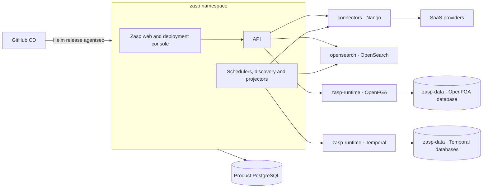

# First deployment on a single-node VPS

A fresh `./zasp config init` selects the VPS profile. Install the stateful services once, then deploy signed Zasp application releases to the Production namespace. Each application rollout leaves the independent Nango and OpenSearch releases running. [Release controls](release-advisories.md) · [Provider matrix](infrastructure-providers.md)

## 1. Prepare and identify the host

Start with one x86-64 Linux VPS, 8 shared vCPUs, 24–32 GB RAM, and about 200 GB of SSD/NVMe. These are planning estimates. The three CNPG clusters request 10 GiB each and OpenBao defaults to 8 GiB. Add capacity for Nango, any additional databases, rolling migrations and encrypted restore staging. A single VPS is one failure domain. Keep recovery receipts, keys and artifacts on independent storage.

Install a supported, version-pinned k3s release on the target. Verify the architecture and SHA-256 using the official release before executing its installer. On a fresh host, put the chosen release’s `k3s` binary and official `sha256sum-amd64.txt` together in `/secure/k3s-release`. Obtain and review the installer at `/secure/k3s-install.sh`. The commands below enable Kubernetes Secret encryption and leave public ingress to the operator. Install the CloudNativePG operator required by the dependency package, a persistent StorageClass, an enforcing network policy controller, Helm, and the command-line tools listed by doctor. Restrict SSH to known operator networks. Keep the Kubernetes API private. [K3s installation](https://docs.k3s.io/installation/airgap) · [K3s Secret encryption](https://docs.k3s.io/security/secrets-encryption)

```sh
(cd /secure/k3s-release && sha256sum --check --ignore-missing sha256sum-amd64.txt)
sudo install -m 0755 /secure/k3s-release/k3s /usr/local/bin/k3s
sudo env INSTALL_K3S_SKIP_DOWNLOAD=true sh /secure/k3s-install.sh server \
  --secrets-encryption --write-kubeconfig-mode 600 --disable traefik --disable servicelb
sudo k3s kubectl get nodes
```

Run ordinary CLI commands as the installation operator with a private kubeconfig and an explicit context. On the *fresh* installation, from the repository root:

```sh
umask 077
./zasp config init
kubectl config get-contexts
# Set ctx to the exact context you verified for this VPS.
kubectl --context "$ctx" get namespace kube-system -o jsonpath='{.metadata.uid}{"\n"}'
kubectl --context "$ctx" get storageclass
```

Copy the context and UID into `ZASP_VPS_KUBE_CONTEXT` and `ZASP_VPS_CLUSTER_UID`. Choose a unique lowercase DNS label starting with a letter for `ZASP_VPS_INSTALLATION_ID`. Set the storage path and class to those actually backing your data. Use a separate private config file for each installation. Preserve an old configuration as-is. For a legacy file without an explicit profile, identify its installation before invoking any operation. [Generated configuration](../../deploy/zasp/zasp.vps.env.example)

## 2. Supply provider resources and identities

| Capability | New VPS selection | Supply before using it |
| --- | --- | --- |
| Connector secrets | `ZASP_CONNECTOR_SECRETS_PROVIDER=openbao` | Dedicated KV v2 mount with `max_versions=1`, workload prefixes and distinct API/discovery tokens. Other production platform secrets still have AWS dependencies. |
| Recovery signatures | `ZASP_RECOVERY_SIGNING_PROVIDER=openbao` | Transit ECDSA P-256 key named with a real UUIDv4. Record that UUID in the workload’s `ZASP_OPENBAO_TRANSIT_KEY`. Preserve historical verifier pins and keys. |
| Evidence | `s3`, `provider-managed` | Pre-provision the real versioned discovery/recovery bucket in the expected account and region with Bucket owner enforced ownership and default SSE-S3. Other evidence stores have separate policies. |
| Job queues | `sqs`, audit encryption `provider-managed` | Pre-provision the actual discovery queue and, where selected, audit work queue and DLQ. Select SSE-SQS on the audit pair. Retain required encryption on every other queue. Discovery and recovery continue to require their KMS-backed queues. |
| Archives | `ZASP_BACKUP_PROVIDER=r2` | Private bucket, account ID, restricted writer credentials, public encryption recipient, and independently retrievable read/decryption credentials. |

Enter the real account, region, S3 bucket and SQS URLs in the generated config. The AWS preflight uses the dedicated `ZASP_VPS_AWS_DOCTOR_ROLE_ARN` and protected `ZASP_VPS_AWS_DOCTOR_TOKEN_FILE`. Bind the doctor role’s trust policy to the installation issuer, audience `sts.amazonaws.com` and subject `system:serviceaccount:zasp:zasp-vps-doctor`. Deliver its rotating token as an owner-only file. The doctor session reads S3 bucket and SQS queue metadata. Qualify runtime writes, KMS grants and redelivery separately. Provision short-lived workload credentials separately for each data-plane role. Keep the customer’s discovery roles and external IDs separate from this infrastructure identity. The VPS installer does not run EKS Terraform. [k3s to AWS identity](k3s-aws-identity.md) · [Evidence encryption](evidence-encryption.md) · [Queue encryption](audit-export-queue-encryption.md)

Record the intended public HTTPS origin and digest references for the three Zasp images. Operator-side manifest inspection may use `ZASP_VPS_REGISTRY_AUTH_FILE`; provision registry access for the cluster separately. Supply a digest-pinned CNPG-compatible PostgreSQL image and set the actual storage and sizing values in each release. Keep credentials out of Helm values and out of shell arguments. Record the live Stytch B2B project ID and public token for `ZASP_STYTCH_PROJECT_ID` and `ZASP_STYTCH_PUBLIC_TOKEN`. Project `ZASP_STYTCH_SECRET_FILE` and `ZASP_STYTCH_WEBHOOK_SECRET_FILE` from protected files. The optional planner receives its own OpenRouter token file. These application settings take effect only in a supported application release. [Workload secret projection](openbao-connector-secrets.md) · [Stytch settings](../getting-started/administrator.md#stytch-settings)

## 3. Install the independent stateful components

Run `./zasp --profile vps install namespaces` with the reviewed installation configuration. It checks the cluster UID and ownership before creating missing namespaces. It leaves unrelated namespaces alone. For an existing evaluation namespace, setup verifies the Helm-owned `zasp` StatefulSet and applies only the installation label. Other existing namespaces must already belong to the installation.

| Namespace | Release and lifecycle |
| --- | --- |
| `zasp` | Production application, Helm release `agentsec`. Existing evaluation release `zasp` has separate ownership. The deployment workflow updates this release after the main commit passes verification. |
| `connectors` | Independent Nango release with its own persistent database, private dashboard and environment credentials. |
| `opensearch` | Independent search service, PVC, certificate identities and index permissions. |
| `staging` | Reserved for future use. The installer creates the namespace only. |



The boxes for OpenFGA and Temporal represent separate Helm releases and pods. Nango uses its own PostgreSQL database. The site supplies the product database, graph, object store and queues through its private release values. The existing evaluation pod belongs to the separate release `zasp`.

1. Create the required namespaces, TLS certificates, protected Secret objects and database identities using the linked component procedures. Label the dedicated managed namespaces `zasp.io/installation=<your-installation-id>`; verify ownership before operating on existing resources. The runtime dependency unit installs separate PostgreSQL clusters for OpenFGA, Temporal persistence and Temporal visibility. Provision a separate persistent Nango database and role. Keep its encryption key and an independently recoverable copy of that key. [Dependency setup and certificates](../../deploy/vps/dependencies/README.md) · [Independent service setup](vps-independent-services.md) · [Nango database and TLS](independent-nango.md)
2. Set `ZASP_VPS_OPENBAO_VALUES_FILE` and `ZASP_VPS_NANGO_VALUES_FILE` to reviewed absolute paths. Prepare the trusted CAs and scoped operator credentials in the file locations named by the config. Preview each install with `--dry-run`, then run the selected steps:

   ```sh
   ./zasp --dry-run install dependencies
   ./zasp install dependencies
   ./zasp status dependencies
   ./zasp --dry-run install openbao
   ./zasp install openbao
   ./zasp status openbao
   ```

3. The first OpenBao status check reports an uninitialized instance and can exit with a nonzero status. On a secured *off-VPS* workstation, use the same checkout, cluster binding, and a private operator config. Set `ZASP_VPS_OPENBAO_PGP_KEYS_DIR` to the verified custodian public keys and `ZASP_VPS_OPENBAO_HANDOFF_FILE` to a new file on independent storage. Initialize once. Each authorized custodian decrypts their share privately and enters it at the hidden prompt until the threshold is met:

   ```sh
   ./zasp --config /secure/pilot-operator.env secrets init openbao
   ./zasp --config /secure/pilot-operator.env secrets unseal openbao
   ```

   Never place shares or a root token in `zasp.env` or distribute them to application pods. Use the initial operator session to establish administrative auth, least-privilege workload policies and the separate status token. In supported workloads, `ZASP_OPENBAO_ADDR`, `ZASP_OPENBAO_CA_FILE`, `ZASP_OPENBAO_TOKEN_FILE` and `ZASP_OPENBAO_KV_MOUNT` select the verified service and KV mount. Issue a separate token per workload. Revoke the bootstrap root token after testing independent access. Verify authenticated health, take an offsite Raft snapshot, and repeat the snapshot after key creation or rotation. On restart use the original shares, then resume the component command. Keep auto-unseal recovery keys separate from an external seal provider’s encryption key. [OpenBao operations and replacement-node recovery](openbao-vps.md) · [Signing authorities](recovery-signing-providers.md)
4. Install Nango only after its PostgreSQL database, verified TLS trust, encryption key and environment service key are ready. Its administrative endpoint remains private. Configure each actual integration and callback with its own credentials. An unconfigured optional integration stays unavailable.

   ```sh
   ./zasp status openbao
   ./zasp install nango
   ./zasp status nango
   ./zasp doctor
   ```

   For separately operated services select `ZASP_VPS_OPENBAO_MODE=existing` or `ZASP_VPS_NANGO_MODE=existing`. The supported authorities are `https://openbao.<namespace>.svc:8200` and `https://nango.<namespace>.svc.cluster.local:8443`. An off-cluster service needs private routing, DNS, matching TLS and network policies for that authority. Its operator controls all lifecycle changes. A shared Nango environment key can access connections across that environment; provision separate environments or instances where application trust boundaries differ. After an interruption, run the named component’s status check and rerun its install using the same config and ownership binding. Resume unseal on the initialized instance. Investigate ownership or schema conflicts before continuing.

## 4. Configure access and evaluate the application gate

For a future application cutover, choose a hostname such as `zasp.example.com` and use its exact HTTPS origin in the Zasp release, Nango values and callbacks. Create a Cloudflare A record for the host's IPv4 address; add AAAA only with working origin IPv6. For a proxied record, install a valid origin certificate covering that hostname and select **Full (strict)**. Restrict origin HTTPS to the trusted proxy addresses. Trust forwarded client addresses only from the ingress and proxy hops you actually control. If using DNS-only or another DNS provider, install a publicly trusted certificate for direct browser access. Keep the DNS and routing cutover pending until a qualified application backend is ready. [Cloudflare DNS](https://developers.cloudflare.com/dns/manage-dns-records/how-to/create-dns-records/) · [Verified origin TLS](https://developers.cloudflare.com/ssl/origin-configuration/ssl-modes/full-strict/)

Keep PostgreSQL, Neo4j, OpenSearch, Temporal, OpenFGA, OpenBao, Nango administration and internal health off the public ingress. For an authorized operator check from a workstation with private Kubernetes access, forward OpenBao locally and verify its certificate SAN. Supply the actual namespace and CA path:

```sh
kubectl --context "$ctx" -n openbao-system port-forward --address=127.0.0.1 pod/openbao-0 18200:8200
# In a second terminal; the body contains the server's health state.
curl --cacert /secure/openbao-ca.pem --resolve openbao.openbao-system.svc:18200:127.0.0.1 \
  https://openbao.openbao-system.svc:18200/v1/sys/health
```

Register Stytch Login/Signup at `<origin>/auth/callback?state={}` and Invite at `<origin>/auth/callback`. SaaS integrations use `<origin>/api/v1/integrations/oauth/callback`. Only the public product endpoints should receive those callbacks. [Provider callbacks](saas-connectors.md) · [Stytch configuration](../getting-started/administrator.md#stytch-settings)

Install the independent OpenSearch chart with the per-service certificates and security settings. Give each consuming Zasp workload its own client Secret. For a cutover, verify or rebuild the inventory and session indexes from the source system before admitting traffic. [Search installation and certificate assignments](../../deploy/vps/opensearch/README.md) · [Client behavior](search-provider-compatibility.md)

If the live UI runs on the evaluation pod, keep its service and volume while transferring the data directly. Move traffic after verifying the new application can read the same inventory and members. [Direct evaluation cutover](vps-evaluation-cutover.md)

Prepare the site’s product database, identity provider, graph, object storage, queues and workload identities in the private hosted-chart values. Set the deployment identifier and provision the operator console password and database credential. Bind the approved application images and the rendered Production overlay to the release evidence. Then install from the selected VPS context.

```sh
./zasp --profile vps install application
./zasp --profile vps status application
```

The first install verifies the cluster UID and namespace owner and refuses to replace an existing release. Routine deployments use the same signed release checks in GitHub Actions. Enable CD after configuring the runner, environment and evidence producers. The independent services retain their own upgrade and backup schedules. [Production CD enrollment](release-advisories.md) · [Deployment Administrator console](deployment-admin.md)

## 5. Verify offsite recovery before relying on these services

Copy `deploy/vps/backup/sources.example.json` to the private file named by `ZASP_VPS_BACKUP_SPEC_FILE`. Define the actual backup sources and independently retained receipt inventory. Include the service databases, OpenBao Raft snapshot, Nango encryption key recovery arrangement, and validated configuration needed to rebuild. Existing versioned S3 evidence and SQS state keep their separate retention and recovery policies. New front-end image references or an archive alone cannot reproduce that external state.

```sh
./zasp backup /secure/new-backup.receipt.json
# On an isolated recovery host with independent R2 read access and decryption material:
./zasp --config /secure/recovery.env restore /secure/new-backup.receipt.json --yes
```

On the recovery host set `ZASP_VPS_INSTALLATION_ID` to the source installation ID in the trusted receipt and manifest. Restore validates that binding and stages into a new directory. Follow the service-native recovery procedures before switching any endpoints. On a fresh machine, verify database roles/schema, the original Nango key and connections, an old signature, a new signing operation and an authorized reference read. Keep the trusted receipt separately. After a successful restore rehearsal, enable `zasp-backup.timer` and monitor the age of verified receipts and the service result. The default cadence is daily at 03:00 UTC with jitter. Explicit `./zasp backup prune --yes` keeps configured generations and the last drilled receipt. [Backup sources, timer, retention and recovery](vps-backups.md) · [Archive encryption](offsite-backups.md)

## Upgrades, rollback and alternative targets

Record the installed Helm revisions, image digests, values, provider configuration and schema versions before upgrading. Obtain and drill a backup appropriate to the affected component. The CLI currently stops before upgrading managed OpenBao or Nango because it cannot verify a recovery rehearsal tied to the installed release. Follow the component runbook to bind the rehearsal to the release and deploy a reviewed revision in a maintenance window. Verify schema compatibility and authenticated component status before returning traffic. A Helm rollback restores executable resources. Migrated database state needs a compatible schema or a tested database restore coordinated with stopped writers. Retain original AWS keys, Transit key versions, evidence versions, and verified backups when switching providers. Operate Nango and OpenBao independently of the application. Preserve their namespaces, PVCs and keys during an application rollback.

| Alternative | Supported operator path |
| --- | --- |
| Local or Kubernetes evaluation | With a fresh config path, use `./zasp --profile local --config /secure/local.env config init` or substitute `kubernetes`. Use synthetic data. |
| Complete AWS/EKS topology | Use `./zasp --profile aws --config /secure/eks.env config init`. Keep its state, credentials and workload settings distinct. |
| AWS signing or connector secrets | On a supported production workload select `aws-kms` or `aws-secrets-manager` for that capability; migrate records and retain historical verifier access before changing writers. |
| Local or S3 backups | Select `ZASP_BACKUP_PROVIDER=local` or `s3`; supply the recipient and independent recovery material. S3 also requires `ZASP_BACKUP_REGION` and `ZASP_BACKUP_EXPECTED_BUCKET_OWNER`. See the VPS backup runbook for its scheduling/retention limits. |
| R2 core evidence or Cloudflare Queues | Unavailable in the application. R2 is supported for archives. The evidence and delivery contracts require versioned S3 and SQS. |

## Verification

| Area | Exercise and result |
| --- | --- |
| CLI and manifests | The CLI generated a private config and preserved existing profiles. Local dry runs left the target untouched. Hosted Helm rendered the evaluation chart, private OpenBao/Nango charts and pinned Temporal/OpenFGA charts. |
| Database recovery | Hosted CI dumped a populated PostgreSQL 16 database over verified TLS, restored it into a fresh database, and checked the recovered row. The VPS dependency installer targets PostgreSQL 18. |
| OpenBao | Hosted CI initialized a real TLS-protected server with PGP recipients, unsealed it with three custodians, and checked scoped authentication. A separate two-server drill restored a Raft snapshot and verified retained KV data and Transit signatures. |
| AWS and R2 | Tests exercised provider selection, identity isolation, encryption, receipts and integrity through controlled fixtures. Live bucket tests require operator-provided accounts and credentials. |
| Target VPS | Verify cluster identity, application readiness, Nango login, a provider sync, search access, backup and host reboot on the installation. The automation tests run against isolated infrastructure. |

The CI run records which checks executed for these deployment scripts. Repeat the cluster, bucket and recovery checks for the installation you intend to use. [Hosted infrastructure results](https://github.com/crossbizz/zasp-sec/actions/runs/45741762439)
