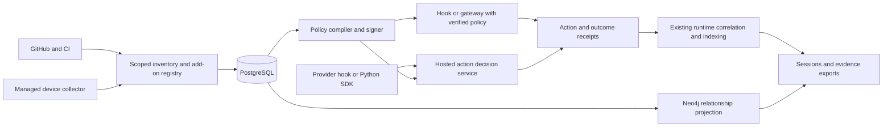

# Zasp Feature V2 Technical Implementation Plan

**Status** Proposed engineering plan for [Feature V2](feature-v2.md). Repository baseline `2f2ad720`. Paths and operations marked proposed describe work to build. Start with work packages `T00` and `T01`, then deliver the first managed-device pilot before adding more surfaces.

The first release should prove one journey on a managed device. A developer runs a private inventory, the enrolled collector reports the exact versions it observes, an authorized reviewer approves a version, and a supported Claude Code hook records and blocks a configured tool action. Zasp shows the decision and verifies the effect against a staging fixture. A locally edited skill is flagged independently of its approved repository copy. Those are two separate pieces of evidence unless the harness can establish which version was used during the action.

## Work packages and order

| ID | Deliverable | Depends on | Feature coverage |
| --- | --- | --- | --- |
| T00 | Verify pilot infrastructure and run harness capability checks | Existing V1 deployment | V2-02, V2-03, V2-07 |
| T01 | Versioned action, enrollment, and add-on contracts with scoped storage | T00 findings | V2-01, V2-02, V2-03, V2-05 |
| T02 | Shared manifest, local CLI inventory, and offline scan engine | T01 manifest contract | V2-03, V2-05, V2-07 |
| T03 | Add-on registry, CI submissions, review, and drift | T01, T02 | V2-01, V2-05 |
| T04 | Device enrollment, managed macOS install, and inventory reconciliation | T01, T02 | V2-03, V2-05 |
| T05 | Signed endpoint policy, Claude Code hook, and action evidence | T01, T04 | V2-01, V2-02 |
| T06 | Add-ons, Devices, and Session UX plus first pilot report | T03, T04, T05 | V2-01, V2-03, V2-05, V2-07 |
| T07 | Real hosted-gateway verification, Claude Enterprise adapter, and Python SDK | T05 | V2-01, V2-02 |
| T08 | Supervised containment, readback, expiry, and release | T05, one verified target adapter | V2-02 |
| T09 | Managed Chrome, then Windows/Intune, Edge, and Codex coverage | T04, T05 | V2-02, V2-03, V2-05 |
| T10 | Side-effect verification and change-triggered regression tests | T05, T06 | V2-06 |
| T11 | Purpose declarations, behavior baselines, and guardrail suggestions | T05, T10 | V2-04, V2-06 |
| T12 | Private central scans, dependency refresh, and more add-on types | T03, T04 | V2-05 |
| T13 | Authenticated CLI, repeatable evaluation, and enterprise release evidence | T06, verified surfaces selected for release | V2-07 |

Build T02 first and start the API side of T04 once the manifest and inventory contracts are stable. Adapter development for T07 and T09 can start after T05. Roll out the first managed-device cohort through T06 before expanding to those surfaces. If fleet or provider access is pending, proceed with contract and fixture work and keep the corresponding real-world gate open. Treat Android, iOS, system-wide process monitoring, and a public add-on marketplace as separate product decisions. Customer demand for Windows can swap the first OS and MDM combination while preserving the same acceptance journey.

## Architecture and existing code



| Boundary | Existing code to start from | V2 implementation |
| --- | --- | --- |
| Public API and authorization | [API operation registration](../../services/platform/apiserver/composition.go), [authorized transactions](../../services/platform/apiserver/authorization_transaction.go), [production composition](../../services/platform/agentsec-api/production_runtime.go) | Register typed routes through the existing production composition. Add operation-specific scope checks and SQL admission. Keep public web, managed-client, provider callback, and worker credentials distinct. |
| Runtime policy | [Content guardrails](../../services/platform/guardrail/guardrail.go), [runtime action policy](../../services/platform/policy/runtime.go), [signed policy cache](../../services/platform/policy/gateway_cache.go), [gateway control](../../services/platform/gatewaycontrol/http.go) | Preserve the existing text decision contract. Share action normalization and policy evaluation across V2 surfaces. Extend the existing Ed25519 envelope pattern with endpoint-specific authority, audience, and version. |
| Inventory and evidence | [GitHub agent discovery](../../services/platform/connectors/githubdiscovery/agent_project.go), [agent access](../../services/platform/apiserver/agent_access.go), [graph projection](../../services/platform/graphstore/snapshot.go), [runtime events](../../services/platform/runtimeevent/runtimeevent.go) | Store scoped source facts in PostgreSQL and refer to their IDs from projections. Keep possible reach, effective permission, and observed use as different facts. Project selected relationships to Neo4j and send event history through the existing runtime pipeline. |
| Async work, response, and reporting | [Worker wiring](../../services/platform/agentsec-worker/production_runtime.go), [Security Agent action catalog](security-agent-action-readiness.tsv), [Red Team worker](../../services/platform/agentsec-worker/red_team_production.go), [compliance export worker](../../services/platform/agentsec-worker/compliance_export_production.go) | Use the existing workflow and outbox patterns. Add work types only for discrete jobs such as scans, reconciliation, and replay. Reuse current approvals and evidence grant flows. |
| UI, CLI, and deploy | [Production navigation](../../app/components/ZaspProductionApp.tsx), [typed API client](../../apps/web/api/client.ts), [OpenAPI](../../openapi/openapi.yaml), [UI operation map](ui-api-map.yaml), [current operator CLI](../../zasp) | Extend current screens in `app/features`. Add a user-facing Go command at proposed `cmd/zaspctl`, separate from `./zasp` and the operator tooling under `cmd/agentsecctl`. Put packaged endpoint assets under proposed `deploy/endpoint`. |

PostgreSQL remains authoritative for registry state, policy, credential lifecycle, and authorization. Use the existing event archive and search projection for runtime history. Neo4j can be stale or down while actions still evaluate. Reuse existing policy compiler behavior where field/operator support fits. Add closed, typed conditions to that path and use shared conformance fixtures across evaluators. Keep the legacy guardrail decision API and gateway wire formats compatible.

## T00 Verify the environment and supported harness events

1. Run the current product against the installed local baseline and record known failures before changing it. Capture one existing managed sign-in, GitHub or AWS discovery sync, finding read, and rendered Sessions result. Use the [launch plan](../internal/mvp-launch-plan-2026-11-12.md) as the list of open verification gaps. Label emulated and real-provider results separately.
2. On a managed test Mac, pin one supported Claude Code build and capture sanitized fixture events for session start, `PreToolUse`, post-tool and failure events. Verify policy precedence, what happens when the hook is missing or times out, which IDs survive resume and sub-agent calls, and whether the harness identifies the exact loaded skill. User-entered skill commands and model-initiated skill calls can follow different events. Test them separately and label unsupported cases in the capability record. [Claude Code hook contract](https://code.claude.com/docs/en/hooks)
3. Confirm which Jamf enrollment material can be issued per device. If no trusted fleet identity can be mapped during enrollment, use single-device registration for the pilot. Record macOS and harness versions, group assignments, and how install, upgrade, rollback, and removal will be exercised. No caller-reported serial number or hostname establishes device identity.
4. Prepare an authorized staging target that records one harmless durable side effect, such as updating a synthetic ticket. Prepare a second allowed operation for a positive control. Capture baseline hook latency and capability results for the exact package and harness versions used.

**Exit gate.** The route and credential authorities for each pilot surface are known. A documented hook can stop the selected action before dispatch. If exact skill identity is unavailable, the pilot ships installation drift and action enforcement with usage displayed as unknown for that surface.

## T01 Establish the contracts and data model

Use names below as proposed logical records. Implement tables and functions in the owning PostgreSQL schemas, using existing product IDs and Organization, Workspace, and Environment scope conventions. Validate cross-object references in SQL as well as application code. Index scoped list and join paths before wiring screens.

| Record | Identity and fields needed first |
| --- | --- |
| Enrollment and binding | `device_id`, credential ID and public key or trusted enrollment identity, Environment, cohort, generation, state, expiry, last check-in. A binding maps a device, provider hook, gateway, or workload to its authorized scope and declared capabilities. Credential rotations keep the device ID and retire the old credential. |
| Device inventory report | ID, device, collector version, root or profile scope, generation, canonical digest, coverage, observation time, receipt time, and submission state. Unique per device, inventory partition, and generation. A complete report advances the active inventory for its own partition. |
| Add-on and version | Add-on type, source origin and publisher evidence, immutable manifest digest, digest format version, dependency facts or explicit unknowns. Deduplicate complete content within the authorized tenant boundary while keeping source, installation, and review records independent. |
| Installation | Stable source-scoped installation ID, device or repository, project or profile reference when known, observed version or unresolved version, first and last seen, active or removed state. A machine-local path may be represented centrally by a scoped opaque identifier and a safe display label. |
| Scan and review | Immutable scan result for an exact version, engine and rule-set version, evidence scope, coverage, and outcome. Review revisions include the deciding principal and a version plus origin and scope restriction, reason, timestamps, and expiry. Store expected revision on writes to prevent lost updates. |
| Action and decision | Stable action ID, adapter binding, provider or harness session and tool-call IDs, operation, classified resource, provenance for principal and add-on references, policy revision, mode, verdict, and reason. Unique action admission within scope and adapter. Store the canonical request digest and issued decision so replay can return the original receipt. |
| Outcome and evidence | One or more supported observations related to the action, with source, confidence, timestamp, and verified outcome or explicit unknown. An `allow` decision says the policy permitted an attempt. Completion needs separate evidence. A `block` decision says what the evaluator decided. Record application of the block separately. |
| Purpose, suggestion, rollout, and containment | Purpose and suggestion revisions reference facts and a policy draft. Use existing policy rollout and Security Agent workflow authorities. Track expected revision, target, acknowledgement, expiry, and independent verification for every effect. |

### Shared API and authority rules

- Define `action.v1`, `inventory-snapshot.v1`, and `addon-manifest.v1` as strict bounded schemas. Give public response enums closed meanings and document unknown fields or statuses. Add versioned operations or media types where a strict older caller would reject extra fields. Publish example fixtures and run the same contract vectors in Go, TypeScript, and SDK adapters as applicable.
- Authorize each request before idempotency or resource lookup returns any previous result. Derive scope from an authenticated browser request, scoped API token, verified device key, or verified provider delivery. A provider session string, hostname, or `agent_id` in the body is a claim until it matches an authorized binding. Use existing `domain.Scope`, browser scope headers, freshness rules, and request-bound SQL proofs. Scope read counts and pagination as well as writes.
- Use `Idempotency-Key` for externally retried changes and an expected version for review, retire, policy, and configuration edits. Device batches may use a scoped generation and digest for equivalent replay semantics. Duplicate exact inputs return the same result, conflicting inputs fail with a stable conflict response, and stale writes cannot replace newer state. Keep browser mutations on the existing same-origin and CSRF path.
- Write authoritative records and their outbox events in the same transaction. Publish after commit and make consumers idempotent. Use a stable per-aggregate revision so a late message cannot revive a retired device, stale review, or expired control. A worker only gets the scope and permissions necessary for its job.
- Reuse current schema sealing and generated artifacts. Add scoped functions and grants without direct app-role access to new tenant tables. Update source SQL and regenerate the baseline through the documented generator. Prove fresh installation as the existing non-superuser operator. The current installer only handles a fresh baseline. Before rollout to an existing customer, prove an additive, data-preserving upgrade and catalog acceptance process on a copy with old IDs, credentials, and historical data. A fresh disposable pilot can use the new baseline while that work proceeds. [Baseline schema and integrity](../operations/baseline-schema-install.md)

**Exit gate.** Installed PostgreSQL tests prove two Environment scopes are isolated, duplicates and stale revisions behave correctly, browser and machine identities cannot cross authority, and existing API payloads and clients still work. A feature flag defaults new surfaces to unavailable until their dependencies are ready.

## T02 Build local inventory, manifest, and private scan

1. Add a small shared Go manifest package under `services/platform` and a proposed `cmd/zaspctl` command. Reuse existing discovery rules when semantics match, including [skill metadata helpers](../../services/platform/agentsignals/skills.go) and [MCP declaration parsing](../../services/platform/agentsignals/mcp.go). Keep OS and harness adapters separate from the canonical manifest encoding. Start with supported Claude Code managed, personal, project, and installed plugin roots. Scan an explicit project selection with its uncommitted files. Do not scan an entire home directory.
2. Enumerate only bounded, approved roots. Use regular files, relative paths, and root-contained reads. Skip symlinks and junctions in the first adapter and report the gap. Reject paths outside the root, case collisions that cannot be represented consistently, unsupported entries, and input over configured count, byte, or time bounds. If a file changes during read or a root becomes unreadable, return partial rather than reusing a complete digest. Parse MCP declarations without starting local processes or contacting declared servers. Preserve only normalized endpoint identity and capability information needed by policy.
3. Define `addon-manifest.v1` as a canonical ordered list of normalized relative path, byte count, and SHA-256 of file bytes, under a declared bundle root. Sort paths by byte order, preserve bytes and case, and use the same encoding and version in device and CI. Include the entry file, bundled scripts and resources, and selected dependency manifests and lockfiles. Keep execution metadata, upstream commit and origin, resolved dependency identity, and scanner coverage separately. Equal bundle digests establish equal covered bytes. They do not establish equal live dependency resolution or identical loaded code. An incomplete manifest cannot inherit approval.
4. Implement `zaspctl addons inventory --local` and `zaspctl addons scan <path> --local` before authenticated CLI commands. Preserve the CLI exit codes and JSON output in the spec. Keep scans private and network-free in local mode. Compare the pinned Cisco and NVIDIA candidates against a fixture set, license and packaging constraints, supported OS and languages, and stable output. Start with one static engine interface and typed rule findings. Cache results by manifest, scan profile, and scanner rule version. Scanner failure or absent inputs produce an incomplete report. [Cisco Skill Scanner](https://github.com/cisco-ai-defense/skill-scanner) · [NVIDIA SkillSpector](https://github.com/NVIDIA/SkillSpector)

**Exit gate.** The same fixture produces the same manifest on a laptop and in CI. A change to one bundled file or lockfile yields a new version. A skipped or changing file yields partial. The offline command needs no account or network and produces no bundle execution. JSON output and exit status match the Feature V2 CLI contract.

## T03 Add registry, review, and version drift

1. Add scoped read and review operations under `/addons`, `/addon-versions`, and `/addon-scans`. Use existing current-principal authorization, optimistic revision controls, and audit receipts. A reviewer sees the version, origins, scan completeness, and affected installations. Approval of a hostname remains a separate policy from approval of an add-on version.
2. Add a narrow CI submission operation via `POST /addon-scans` with `findings_only` mode. Bind CI access to its authorized repository and Environment. Record the CI provenance and digest, and distinguish client-reported findings from an independently performed scan. For the pilot, GitHub discovery can keep its metadata-only reads while CI supplies complete byte digests for selected commits. Add optional bounded GitHub content reads later if the integration owner approves the data flow. A Git blob ID cannot be substituted for the local manifest digest.
3. Compare the active installation with its scoped review and dependency observations. Write a deterministically identified finding for new unreviewed bytes, a revoked version, a disallowed origin, or a relevant material dependency change. Deduplicate concurrent processing. Closing a finding requires reconciled current evidence, such as an approved replacement or a complete observation of removal. Separate versions with identical human names and preserve installation history.
4. Add an outbox consumer that updates agent and repository associations and reports the affected enforcement points on review changes. Include version approval facts in an effective policy bundle only for adapters that can verify the version at the action point. An inventory-only adapter can generate a finding and report coverage. It cannot assert a block.

**Exit gate.** An approved CI version matches its laptop installation. A different local copy is flagged. Duplicate scan submissions do not create duplicate history, unauthorized approvals mutate nothing, and a revocation updates coverage until the adapter acknowledges it. Partial observations do not close findings.

## T04 Enroll devices and reconcile inventory

1. Add Device and Enrollment operations in the existing API composition. Admin operations issue an expiring, tenant- and cohort-scoped bootstrap configuration. The exchange consumes a one-time invitation or verifies an approved MDM-backed identity and binds a per-device key. Issue no fleet-wide privileged runtime token. Store or reference credentials using OS-protected storage, and expose rotations and retirement independently of uninstall status. Treat an interactive OS account as a local observation until its corporate principal is verified.
2. Ship a signed, notarized macOS package with managed settings and a small user-context collector. Start with read-only inventory and hook integration, so discovery of user-scoped files does not require root or broad disk access. Keep device trust enrollment, credentials, and policy cache separate from writable project directories. Jamf distributes config and the package. A rollout becomes healthy only after the expected device both checks in and acknowledges the appropriate policy. [Jamf deployment](https://learn.jamf.com/r/en-US/jamf-pro-documentation-current/Package_Deployment) · [Apple notarization](https://developer.apple.com/documentation/security/notarizing-macos-software-before-distribution)
3. Implement heartbeat and inventory generation handling. Record expected cohort membership where the admin can establish it. Maintain separate times for heartbeat, last successful inventory, and applied policy. Submit bounded canonical reports with partition scope and completeness. Apply a complete generation atomically within its own root/profile partition. Update additions from partial reports with a partial marker and keep prior observations. Mark a missing installation removed only after a newer complete report for that partition. Watch events can schedule a bounded rescan. Treat periodic complete reconciliation as the authority for removal.
4. Add durable local spooling for bounded metadata when disconnected, with retry and jitter, counts for dropped records, and a forward-compatible device health report. Timestamps include device observation and server receipt. Show old or disconnected devices as stale after the configured threshold. Retirement rejects future ingress from that binding. Previously collected evidence follows retention, and removal of software is verified by MDM independently.

**Exit gate.** Verify enrollment, rotation, install, two complete inventory generations, incomplete scan, offline/reconnect, upgrade, rollback, and retirement on real test devices. A reused enrollment proof cannot claim a second device as the first. A replayed snapshot cannot replace a newer one or mark another project's skills removed.

## T05 Stop a supported tool call and retain evidence

1. Implement a versioned adapter interface with `pre_action` and `outcome` messages. Derive a stable action key from the scoped binding, source session ID, and the harness's tool-call ID when stable. If the source cannot establish a reliable identifier, retain an unknown correlation state and do not assert a match across adapters. Permit late outcomes to wait for their matching attempt for a bounded period. Keep the event time and ingestion time separate. Group old gateway activity by its existing daily rollups and clearly label that granularity.
2. Compile allowed typed conditions through the existing policy path. Extend the signature and cache format for the endpoint audience with scope, adapter binding, policy revision, key ID, monotonic sequence and expiry. Reuse the existing Ed25519 trust model. Keep private signing keys off endpoints. The device verifies and atomically installs only a newer, valid bundle. Rollback issues a new signed sequence carrying the earlier rules. Operation-level blocks and containment take precedence over recommendations; absence of optional model context cannot relax an active policy. [Existing policy envelope and cache](../../services/platform/policy/gateway_cache.go)
3. Wire the managed Claude Code hook to a local evaluator. Normalize only fields needed to decide. Prefer a cached rule evaluation over a per-tool network request, and keep raw transcripts and tool arguments out of the local spool and logs. For a blocking decision, return the vendor-supported deny result before execution. Record post-tool success or failure separately if the harness reports it. Keep `Monitor` as allowed execution with a separate `would_block` result. This hook protects mapped actions. Claim exact-version load enforcement only when the adapter can bind the check to the version the harness will actually load. A digest previously computed from a mutable path supports inventory evidence only. [Claude Code hook reference](https://code.claude.com/docs/en/hooks)
4. Add `POST /runtime/action-decisions` for hosted synchronous callers and `POST /runtime/actions/{actionId}/outcomes` for subsequent observations. Add a bounded machine-ingest operation such as `POST /runtime/observations` for signed local decision receipts and browser observation batches. A local decision may arrive after its action. Verify envelope provenance and the recorded policy revision without reevaluating historical attempts against current policy. Link the normalized records to Sessions through existing correlation and indexing workers. Expose `GET /runtime/enforcement-points` for authorized product reads and a credential-bound policy sync operation such as `GET /runtime/enforcement-points/{id}/policy?after=<sequence>` for managed clients.

Illustrative hosted request and response. Authentication establishes the binding and tenant. The relative safety label on a target comes from validated policy input and supporting evidence, with an explicit unknown when unresolved.

```json
{
  "schema_version": "action.v1",
  "action_id": "test-action-14",
  "source_session_ref": "test-session-3",
  "source_call_ref": "test-tool-call-14",
  "action_kind": "tool_call",
  "operation": "ticket.update",
  "resource": {"kind": "ticket", "classification": "pilot_restricted"}
}
```

```json
{
  "action_id": "test-action-14",
  "decision_id": "test-decision-14",
  "mode": "enforce",
  "verdict": "block",
  "reason_code": "resource_outside_scope",
  "policy_revision_id": "test-revision-7",
  "coverage": "pre_action_supported"
}
```

Once a hosted decision is committed, return its receipt on authorized, identical retries. A subsequent user retry of the action has a new action ID. Preserve verification failures as transport or policy-state failures separate from deny decisions. A scoped opt-in policy for a high-risk operation requires the adapter to stop the operation when a required decision is unavailable. Exclude an adapter from that rollout if its installed version cannot enforce the selected failure behavior. Apply an unexpired cached policy during a brief outage, display degraded status, and use the configured action fallback when the bundle expires. Verify the outcome of hook failure or unavailable policy on the actual harness version.

**Exit gate.** Controlled staging tests show the check happens before dispatch. A permitted call produces a target receipt, a blocked call does not, and both have accurate Session evidence. Duplicate and out-of-order observations remain consistent. An invalid bundle, expired bundle, disconnected controller, and two concurrent sessions are exercised on the test harness. Neo4j and model availability do not control this path.

## T06 Deliver the first pilot UI and evidence report

1. Add **Tools & MCP → Add-ons** and **Sensors → Devices** to existing production screens. Use an API-backed registry list, version detail, installation list, and device health with cursor pagination and appropriate capability gates. Put the principal's writable actions next to their status. Use the existing typed API client and update `openapi/openapi.yaml`, generated client types and decoders, `docs/product/ui-api-map.yaml`, and Fern docs together. [Web client generation](../../package.json) · [Current sensor UI API](../../app/features/sensors/api.ts)
2. Add provenance and freshness to Agent detail and make linked action evidence available from the Session detail. Use authoritative inventory reads for version, permission, and review status. Project stable add-on and relationship IDs via the existing graph worker. A stale graph leaves direct inventory readable and hides or labels affected graph enrichments. Keep event history out of Neo4j. `Installed`, `Observed in use`, `Review required`, and `Can enforce` are separate attributes.
3. Add a first pilot report from the existing agent evidence pack path, with a versioned response if needed, and retain access checks on linked evidence. Include a permission/coverage legend, the scenario receipt, policy revision, installation drift example, and unsupported cases. Add session and cohort filters to the existing compliance export contract in T13 and preserve fresh browser authentication for retained downloads. [Evidence pack handler](../../services/platform/apiserver/agent_evidence_pack.go)

**Exit gate.** A pilot admin can enroll a real test Mac, find the approved and edited copies, see the policy acknowledgment, and open the session showing one allowed and one blocked staged action. Repeat the journey as a security reviewer and verify devices and exports are correctly scoped. Demonstrate separate representations for no activity, stale coverage, unmanaged device, and unsupported surface.

## T07 Add service and application adapters

| Adapter | Build order and proof |
| --- | --- |
| Hosted MCP and model gateway | First reproduce the documented allow/block/redact path against real supported test upstreams. Keep old URL, token, redaction, and stream semantics. Add an authenticated binding for per-session detail only where supported. Persist the actual MCP or application call ID if available. Keep existing daily rollups for traffic that cannot be joined. Exercise a streaming response, retry, upstream outage, and gateway policy update on a deployed instance. |
| Claude Enterprise | Register a connector and verified callback in the production API. Use Anthropic's signature and timing contract with server-side tenant mapping, deduplication, bounded payloads, secret rotation, and no raw content retention by default. Convert only supported inputs into normalized actions. Expose test connection, audit or enforce mode, last receipt, and supported events in Integrations. Return only verdicts the provider supports. Suspend-enforcement and timeout behavior require proof in a real test tenant, including a request from an unmanaged device. |
| Python agent middleware | Keep the generated Fern Python API client intact. Add a small runtime package or extras module for `before_tool` and `after_tool`. Bind SDK credentials to an enrolled workload. Wrap real tool dispatch after policy evaluation, propagate stable session and call IDs, emit typed outcomes, and enforce configured deadlines. Ship an integration example against the synthetic staging tool. Transport failure, denial and tool failure raise distinct results. A call outside the wrapper has no SDK coverage. |
| Additional service integrations | Create a per-provider capability entry and sanitized contract fixtures before extending the adapter set. Provider API or audit-log collection may only support detection after the fact. Grant inline claims only for an authenticated pre-action API with verified deny and timeout behavior. |

The shared decision boundary lives under the existing API/policy surface and adapter code stays provider-specific. No adapter gets direct database authority to write approvals or policy. Keep the published provider payload separate from Zasp's internal contract. [Hosted gateway](../operations/hosted-gateway.md#what-was-verified) · [Claude Enterprise inference hooks](https://support.claude.com/en/articles/16059458-inference-hooks-overview) · [Generated SDKs](../../sdks/README.md)

**Exit gate.** Each supported adapter completes a real allow and block, publishes correct evidence, and documents which actions it can preempt. A provider-side block receipt proves the provider's policy response. Record actual downstream effect only when independent evidence establishes it.

## T08 Extend supervised containment

Use the current Security Agent run and approval flow for containment. Start by extending the existing scoped `isolate_session` action to the first verified target adapter. Bind the adapter to the exact governed session, allowed control type, and expiry at approval time. A broader agent-wide pause requires explicit action scope and authorization. The operator sees what can be paused, which point will enforce it, and whether work already in progress can be stopped. Provider cancellation, credential revocation, and local process stop are separate action capabilities with their own provider prerequisites, results, and approval requirements. [Current action readiness](security-agent-action-readiness.tsv) · [Worker wiring](../../services/platform/agentsec-worker/security_agent_action_production.go)

Persist an idempotent outcome per control and target. Authorize again before a dispatch that changes customer state. Publish a scoped control revision and wait for adapter readback or independently observed effect. Distinguish `pending`, `applied`, `verified`, `failed`, `expired`, and `release_pending` where applicable. A disconnected device with no acknowledgement remains pending or unverified. Retries cannot accidentally expand the scope or reset the TTL. Expiry or manual release removes only that control and keeps any other active policy in force. If release never reaches the adapter, alert the operator and retain the verification state. Read back cancellation or credential revocation through the provider when the effect cannot be represented as a policy receipt.

**Exit gate.** A supervised request isolates the selected session, another session remains usable, and a repeat attempt produces the same control receipt. A target check verifies new calls are stopped. Release and expiry remove the control, with failed readback or cleanup visible. A request to stop already-running work is marked unsupported on adapters that only govern future calls.

## T09 Add managed browser and broader desktop coverage

1. Build one Manifest V3 extension first for managed Chrome. Publish a managed configuration and use browser policy to force-install it on the pilot group. Configure tenant binding, supported AI origins and profile restrictions through managed storage. Use the machine ingest contract or a verified local broker where product architecture requires device integration. Keep permissions specific to supported origins and use no page-provided credentials. Send bounded origin, app/session metadata, adapter version, and health. Collect prompts or attachments only through a separately approved feature where the browser surface reliably supports it. [Managed Chrome extensions](https://support.google.com/chrome/a/answer/6306504) · [Chrome request-rule API](https://developer.chrome.com/docs/extensions/reference/api/declarativeNetRequest)
2. Distinguish origin-based network rules, supported in-page signals, and provider-hosted hooks. Do not offer general per-prompt or per-tool browser blocking on the basis of origin rules. A pilot operation only gets a block capability after pre-dispatch behavior is reproduced on the exact application and browser versions. Deduplicate provider and browser signals only with verifiable shared identity; otherwise display both sources without claiming exact correlation.
3. Build the Windows/Intune package using the same core collector and enrollment contracts. Add Windows filesystem and user-context tests for case handling, junctions, package upgrade, and credential availability. Port the selected managed browser extension to Edge and verify install and update separately. Add Codex skill roots and adapter support for documented events. Identify which hook types can block or can only observe, and test event behavior, including error outcomes, on the pinned version. [Intune Win32 deployment](https://learn.microsoft.com/en-us/intune/app-management/deployment/add-win32) · [Managed Edge extensions](https://learn.microsoft.com/en-us/deployedge/microsoft-edge-policies/extensioninstallforcelist) · [Codex hooks](https://developers.openai.com/codex/hooks)

**Exit gate.** For every launched OS, browser, and harness, reproduce enroll/install, first observation, upgrade, rollback, and uninstall or retirement. The UI reports evidence separately by profile, source, and capability. A managed browser can be healthy while a provider hook is absent. An unmanaged profile does not enter the covered numerator.

## T10 Verify prevention against staged side effects

Reuse the existing Red Team definition, run, schedule, and immutable evidence pipeline. Add a distinct `policy_verification` test kind with a closed scenario catalog and explicit development/staging target eligibility. Validate the authorization again when the run starts. Each job binds a target fixture, scenario version, exact policy and add-on versions, unique correlation ID, and expected effect. Use synthetic resources and curated, benign scenario operations. Avoid arbitrary destinations and customer production credentials. [Red Team UX and restrictions](../getting-started/user.md#6-red-team-tests) · [Current probe catalog](../../services/platform/redteam/probes/catalog.go)

1. First run a positive control to establish that an eligible operation reaches the target and makes a receipt. Run the configured denied operation under the exact policy revision. Use the same healthy evidence collector and time bounds. Match the verdict and receipt by run and action IDs. A timeout, missing capability, unavailable recorder, or missing prerequisite cannot count as a prevented effect.
2. Store expected result, actual policy decision, recorder health/completeness, side-effect observation, and classification as separate values. Expose `passed`, `unexpected_effect`, `inconclusive`, and `unsupported` in the versioned run detail. Preserve the existing response-marker test types. Link to Session and retained evidence where authorized.
3. Extend the existing scheduled/change-triggered machinery to act on approved artifact, tool-schema, and policy revision changes. Filter events to affected definitions before queueing. Deduplicate by scope, definition, scenario version, and triggering revision. Bound concurrency. Recheck deployment and target scope whenever the worker claims a job. Publish one immutable result per run.

**Exit gate.** A verified allowed write and a verified denied write produce different receipts. Loss of the recorder is inconclusive. Repeated delivery of a change event queues one eligible test. Existing tests and schedules remain compatible.

## T11 Generate and test draft guardrails

1. Add scoped, versioned Agent purpose records with typed allowed actions, resources, destinations, approval requirements, and an optional owner description. Validate the structured requirements at write time. Version changes are audited and may trigger a new analysis; they do not activate rules on their own. Implement the [Feature V2 API contract](feature-v2.md#api-contracts-for-the-implementation-plan) for purpose and suggestions.
2. Run an asynchronous baseline job using known scoped action receipts and availability windows. Aggregate per agent, operation, resource class, outcome, and policy/model or artifact version where available. Exclude test data from normal suggestions unless explicitly selected. Track event counts, provenance, collection completeness and change windows. For an under-observed agent, surface insufficient telemetry. Avoid mixing older workflows when an agent changes purpose or versions. Observed frequency may rank suggestions, but cannot expand an existing permission.
3. Start with explainable deterministic suggestions and evidence links. If model assistance is enabled, reuse the configured [AI gateway](../../services/platform/aigateway) to propose schema-validated typed rules from bounded approved metadata. Keep it off the action path. Validate referenced IDs, schema and allowed operators, and store model/prompt template version when used. Reject unsupported fields and transformations. A suggestion can create only a draft. The model may neither grant access nor activate policy.
4. Extend policy simulation with a versioned input that explicitly identifies proposal revision, data window, supported cohort, and coverage. Record sampled activity, matches, estimated would-blocks, and unsupported or unknown inputs. Use the same evaluator as enforcement. Ship **Review → Simulate → Monitor → Enforce** through existing policy workflow and authorities. The authorized revert action issues a newer revision and reports acknowledgments. Keep provider and local fallback behavior identical to the policy selected for the cohort.

**Exit gate.** A fixture with an explicitly disallowed operation yields a reviewable proposal and stable reason. A manually allowed operation remains allowed through replay and monitor. Low evidence yields insufficient activity. Suggestions never change active policy until reviewed and activated. Candidate impact is traceable to the chosen fixture or telemetry window.

## T12 Add private central scans and expand the supply chain registry

1. Implement tenant-scoped short-lived upload grants for `POST /addon-scan-uploads`. Bind a grant to the expected size, allowed format, digest and actor. Reuse [existing artifact storage](../../services/platform/artifactstore) and scoped job patterns. Check ownership and digest before queueing `POST /addon-scans`. Store uploads separately from metadata-only reports and apply an explicit expiry policy. Limit archive entries, uncompressed size, nested content, and privileges. Reject unsupported inputs before analysis. A scan worker may update its result and stage receipt, but cannot approve an artifact or see unrelated bundles.
2. Run static checks first in an isolated worker with an allowlisted scanner build and fixed scan profile. Record scanner and ruleset versions and completeness. When dependency advisories or tool schemas change, rescan affected immutable versions or produce a new observation for the changed dependency/remote schema with provenance. Keep approval scoped to the version and allowed origin. Expose changed dependencies and stale review evidence without conflating them with a modified local bundle.
3. Add plugins, sub-agents, commands, and hooks as explicit artifact types with their own parsing and coverage contracts. Introduce an optional behavioral evidence profile only after the static and approval path works. Start with approved synthetic add-ons and constrained test resources, isolated from credentials, employee machines, live services and general network access. Record which behavior was observed and the boundaries of the observation. Keep local and ordinary CI scanning static and private by default. Support only approved external analysis integrations with declared uploads, access, and retention. [AIR add-on lifecycle](https://www.air.security/blog-posts/agent-supply-chain-framework) · [Metano SkillTracer analysis model](https://labs.metano.ai/scanner/faq)

**Exit gate.** Private uploads and findings are visible only to authorized actors and expire as configured. Scans restart safely after worker interruption and report unsupported or incomplete inputs. Changing a dependency or tool schema creates appropriately scoped fresh evidence and reevaluates affected policy or review where configured. An artifact that is approved, installed, and never observed in use shows all three facts distinctly.

## T13 Finish authenticated CLI and release evidence

1. Add `zaspctl auth login` via a browser handoff bound to the initiating CLI and exact Environment. Use the existing identity provider and exchange an expiring one-time binding for a narrow CLI credential. Preserve browser cookie, CSRF, and fresh-auth protection. Keep automation credentials separate. Wire `addons submit`, `device status`, `device doctor`, `guardrails simulate`, and `sessions show` to the supported operations. `evidence export` opens the authorized browser flow where fresh browser authentication is required. Add stable machine-readable output and actionable CLI errors without including keys or raw content.
2. Add the local evaluation report and the guided real-source connection. Extend evidence packs and retained compliance exports with session and pilot-cohort selectors, new coverage values, and stable authorization at capture and download. Include initial versus current inventory, scoped policy results, exact versions, omitted sources, and evidence timestamps. Show active external data flows, retention, deletion, and who can access content. Use the existing audit and export controls. [Compliance worker](../../services/platform/agentsec-worker/compliance_export_production.go) · [V1 release gates](../internal/agent_security_platform_PRD_v1.5.md#21-mvp-release-gates)
3. Run the existing cloud golden path in a deployed test Environment. Verify first admin and member login, selected IdP/SCIM lifecycle where advertised, read-only source setup, a real GitHub or AWS sync, and one approved AWS fix with separate remediation authority and readback. Confirm real gateway, real MDM and SaaS/API integration results for the surfaces sold. Exercise backup, restore, policy rollback, device and credential retirement, and download expiry. Record versions, scope, verification receipts and any unavailable capability. A feature marked available for a pilot must distinguish a test fixture, real provider test, and production operation.

**Exit gate.** A new practitioner can generate a private local report, join a pilot, and reach one corroborated issue through its real source. A security lead can export the controlled-action evidence with known gaps. The deployed Environment preserves current identity, recovery, and change-control behavior. An existing-tenant release waits on the upgrade gate in T01.

## Verification and rollout

| Gate | Required evidence |
| --- | --- |
| Contract and compatibility | Frontend and SDK generated types remain in sync. Existing schema decoders, legacy URLs, scopes, and policy bundle versions retain their current behavior. New response shapes have explicit negotiation or new paths. |
| Installed database and workers | Two independent tenant scopes, request-bound SQL admission, bounded worker roles, rollbacks, concurrency, restarts, stale revisions, outbox retry and cleanup. Verify the non-superuser install and sealed baseline catalog. |
| Endpoint and SDK | Reproducible manifest fixtures across CI and supported OS. Real managed package release, enrollment, restarts, signing-key rotation, same-scope action evaluation and plan equivalence across adapters. Test unsupported source types and stale or offline behavior. |
| Enforcement and privacy | Same policy revision yields the same eligible decision across adapters, and effect-level tests include a healthy positive control. Credentials, raw transcripts, local paths and add-on contents do not enter general diagnostics. Local-only scans work without a network. |
| Customer pilot | Exact OS, browser, harness, provider, data mode and cohort recorded. First useful report, installation drift, scoped denial, verified readback or explicit unknown, and bounded export reproduced without fixture UI. Comparisons clearly identify actual coverage. |

Run targeted Go tests from the owning modules and validate an installed PostgreSQL baseline for state and authorization changes. For public API or UI work use `npm run openapi:lint`, `npm run openapi:test`, `npm run openapi:check`, `npm run ui-api:check`, and `npm run typecheck` plus relevant Vitest or browser tests. Regenerate contracts before running check commands. Keep the existing production release and runnable UI workflows in use. Run `npm run docs:check` and `npm run sdk:test` when their outputs change. [Repository commands](../../package.json) · [UI smoke test](../../scripts/production-ui-api-smoke.mjs) · [UI acceptance workflow](../../.github/workflows/runnable-ui-acceptance.yml)

Measure local hook overhead, provider decision latency, action receipt lag, percentage of expected devices that enroll and acknowledge policy, complete inventory rate, time to detect a changed version, policy false blocks, containment verification latency, and first useful report time. Agree on targets with the pilot team before enforce. Initial engineering targets for the test setup are p95 local hook overhead below 75 ms, visible action receipts within one minute of connected delivery, and changed local versions visible within ten minutes. Validate cold starts and network outages separately. Use the supported route's deadline if it is tighter than a product target. Label cohorts with unknown size and report missing telemetry explicitly.

Release by Environment and cohort. Start with inventory and audit mode, enable enforcement for one tested action on one group, and expand after evidence review. If a rollout must be reversed, stop new sends through the affected adapter or publish a newer signed revision restoring the previous effective rules and confirm which adapters applied it. Keep the previous package available, keep historical decisions queryable, and exercise service and data rollback independently. Cohorts that did not acknowledge are visible work. Avoid dropping schemas or resetting customer IDs to roll back an upgrade.

## Decisions to record before the first build

- Pin the first macOS, Jamf, and Claude Code versions and document the capability test results. Use the pilot fleet's actual platform if a Windows-first path is required.
- Choose the first guarded tool/action and define which of its inputs are trustworthy enough for policy. Publish what can be observed about local skill loading independently of tool blocking.
- Choose the bundle and scan canonicalization versions, local engine, and ownership of the offline packaging and advisory refresh. Record which scan results are eligible for approval.
- Confirm per-adapter timeout, stale policy and offline fallback behavior, signing-key rotation, and credential expiry. Set the pilot measurement window and success thresholds.
- Record exact deployment prerequisites and who can supply a managed test fleet, Claude Enterprise test account, approved AWS sandbox, signing certificates, and a durable staging evidence target. Keep unsupported surfaces disabled until the corresponding exit gate is satisfied.
